# Orderlii — Production Realtime Order Lifecycle Architecture

This document specifies the end-to-end, production-ready order lifecycle architecture for **Orderlii**, detailing transaction boundaries, reliable event publication, authoritative data retrieval, and error recovery across all system participants.

---

## 1. Architectural Principles

1. **Event Notification vs. Authoritative Retrieval**: Realtime events (`order.created`, `table.updated`, etc.) act as lightweight signals carrying identifiers, tenancy scope, and version vectors. They do **not** transmit heavy bloated payloads. Consumers (POS, KDS, Staff App) fetch authoritative aggregates from the backend API, preventing stale race conditions and duplicate financial recalculations.
2. **Transactional Outbox Persistence**: All database state changes (order, items, invoice, table state) and event publishing records occur inside a single atomic PostgreSQL transaction. An outbox processor guarantees *at-least-once* event delivery.
3. **Idempotent Consumers**: Every client maintains deduplication filters using `(event_id, version_num)` tuples to safely tolerate duplicate event delivery.
4. **Tenant and Branch Isolation**: Channel names and WebSocket/SSE subscriptions are strictly segregated by `tenant_id` and `branch_id`. Cross-tenant leakage is prevented by JWT authorization at the Realtime Hub gateway.

---

## 2. Production Sequence Diagram

```mermaid
sequenceDiagram
    autonumber
    actor Client as Customer / Waiter (Staff App)
    participant BE as Backend (Fastify API)
    participant DB as PostgreSQL / Prisma
    participant Hub as Realtime Hub (SSE / WebSocket)
    participant KDS as Kitchen Display (TableOS)
    participant POS as Restro POS

    %% ==========================================
    %% PHASE 1: SUBSCRIPTION & INITIAL SYNC
    %% ==========================================
    rect rgb(240, 248, 255)
    Note over POS, Hub: Phase 1: POS Realtime Subscription & Catch-Up Sync
    POS->>Hub: Connect (JWT: tenant_id, branch_id, role)
    alt POS Subscription Failure (Invalid Token / Network Drop)
        Hub-->>POS: 401 Unauthorized / Connection Error
        POS->>POS: Refresh JWT / Exponential Backoff Retry (1s, 2s, 4s...)
    else Subscription Success
        Hub-->>POS: 101 Switching Protocols (Connected)
        POS->>Hub: SUBSCRIBE channels: ["tenant:{tenant_id}", "branch:{branch_id}:pos"]
        Hub-->>POS: Subscription Confirmed
    end

    POS->>BE: GET /api/v1/orders?branch_id={id}&status=active
    BE->>DB: Query active orders with items, tables & invoices
    DB-->>BE: Active order aggregates
    BE-->>POS: HTTP 200 { orders: [...] }
    POS->>POS: Populate initial active order cache & table status
    end

    %% ==========================================
    %% PHASE 2: ORDER PLACEMENT & TRANSACTIONAL OUTBOX
    %% ==========================================
    rect rgb(255, 250, 240)
    Note over Client, DB: Phase 2: Order Creation & Atomic Database Transaction
    Client->>BE: POST /api/v1/orders/checkout { cart_id, table_id, items, modifiers, idempotency_key }
    
    alt Validation / Pricing Failure
        BE-->>Client: HTTP 422 Unprocessable / 400 Bad Request
    else Successful Processing
        Note over BE, DB: Atomic DB Transaction (Prisma $transaction)
        BE->>DB: BEGIN TRANSACTION
        BE->>DB: 1. Validate tenant, branch, table & menu availability
        BE->>DB: 2. Calculate prices, modifiers, taxes & discounts
        BE->>DB: 3. INSERT INTO orders (id, status='pending', version_num=1)
        BE->>DB: 4. INSERT INTO order_items & order_modifiers
        BE->>DB: 5. INSERT INTO invoices (id, order_id, status='UNPAID', total_minor)
        BE->>DB: 6. UPDATE table_runtime_projections SET runtime_state='OCCUPIED'
        BE->>DB: 7. INSERT INTO outbox_events (event_id, event_type='order.created', branch_id, payload)
        BE->>DB: 8. INSERT INTO outbox_events (event_id, event_type='table.updated', branch_id, payload)
        BE->>DB: COMMIT TRANSACTION
        DB-->>BE: Transaction Committed
        BE-->>Client: HTTP 201 Created { order_id, order_number, invoice_id }
    end
    end

    %% ==========================================
    %% PHASE 3: RELIABLE EVENT BROADCAST
    %% ==========================================
    rect rgb(245, 255, 250)
    Note over BE, Hub: Phase 3: Transactional Outbox Event Distribution
    loop Outbox Processor (Polling / LISTEN-NOTIFY)
        BE->>DB: SELECT * FROM outbox_events WHERE published_at IS NULL ORDER BY created_at ASC LIMIT 50 FOR UPDATE SKIP LOCKED
        DB-->>BE: [outbox_event_1, outbox_event_2]
        alt Event Publication Failure (Hub Down)
            BE->>BE: Increment retry_count, schedule exponential backoff
        else Event Publication Success
            BE->>Hub: Publish event to channel "branch:{branch_id}"
            BE->>DB: UPDATE outbox_events SET published_at=NOW() WHERE id IN (...)
        end
    end

    par Parallel Broadcast to Channels
        Hub-->>KDS: EVENT order.created { order_id, table_id, version: 1 }
        Hub-->>POS: EVENT order.created { order_id, table_id, version: 1 }
        Hub-->>Client: EVENT order.created & table.updated
        Hub-->>POS: EVENT table.updated { table_id, state: "OCCUPIED" }
    end
    end

    %% ==========================================
    %% PHASE 4: POS AUTHORITATIVE AGGREGATION & RENDERING
    %% ==========================================
    rect rgb(255, 245, 245)
    Note over POS, BE: Phase 4: POS Order Extraction, Deduplication & Authoritative Fetch
    POS->>POS: Deduplicate (Check if event_id already processed)
    POS->>POS: Extract order_id from event payload
    
    POS->>BE: GET /api/v1/orders/{order_id} (Header: Authorization, X-Branch-Id)
    alt Order Fetch Network Failure
        POS->>POS: Push order_id to Retry Queue (poll every 2s, max 5 attempts)
    else Order Fetch Success
        BE->>DB: Query order JOIN items JOIN modifiers JOIN invoice JOIN table JOIN customer
        DB-->>BE: Authoritative Order Aggregate
        BE-->>POS: HTTP 200 { order, invoice, table, items, taxes, totals }
    end

    POS->>POS: Update local state & floor layout
    Note over POS: POS renders automatically without manual refresh:<br/>- Order # & Table #<br/>- Customer Name & Source<br/>- Items, Modifiers & Quantities<br/>- Subtotal, Discounts & Tax Breakdown<br/>- Grand Total & Invoice Status (UNPAID)
    end

    %% ==========================================
    %% PHASE 5: KDS TRANSITIONS & STATUS PROPAGATION
    %% ==========================================
    rect rgb(248, 248, 255)
    Note over KDS, POS: Phase 5: Kitchen Status Lifecycle Propagation
    KDS->>BE: PATCH /api/v1/kitchen/orders/{order_id}/status { status: "PREPARING" }
    BE->>DB: UPDATE orders SET status='PREPARING', version_num=version_num+1 + Outbox Event
    BE->>Hub: Publish order.status_updated { order_id, status: "PREPARING", version: 2 }
    Hub-->>POS: EVENT order.status_updated
    Hub-->>Client: EVENT order.status_updated
    POS->>POS: Update order status badge to "Preparing"

    KDS->>BE: PATCH /api/v1/kitchen/orders/{order_id}/status { status: "READY" }
    BE->>DB: UPDATE orders SET status='READY', version_num=version_num+1 + Outbox Event
    BE->>Hub: Publish order.status_updated { order_id, status: "READY", version: 3 }
    Hub-->>POS: EVENT order.status_updated
    Hub-->>Client: EVENT order.status_updated
    POS->>POS: Highlight Order as "Ready for Serving"
    end

    %% ==========================================
    %% PHASE 6: PAYMENT & INVOICE RECONCILIATION
    %% ==========================================
    rect rgb(255, 255, 240)
    Note over POS, DB: Phase 6: Authoritative Payment & Invoice Update
    POS->>BE: POST /api/v1/billing/{order_id}/pay { method: "CASH"|"CARD", amount_minor }
    
    alt Payment Declined / Gateway Error
        BE-->>POS: HTTP 402 Payment Required / 400 Bad Request
        POS->>POS: Display payment error banner, maintain invoice as UNPAID
    else Payment Authorized
        Note over BE, DB: Atomic Payment Transaction
        BE->>DB: BEGIN TRANSACTION
        BE->>DB: 1. Record payment transaction entry
        BE->>DB: 2. UPDATE invoices SET status='PAID', paid_at=NOW()
        BE->>DB: 3. UPDATE orders SET payment_status='PAID', version_num=version_num+1
        BE->>DB: 4. INSERT INTO outbox_events (payment.updated, invoice.updated)
        BE->>DB: COMMIT TRANSACTION
        DB-->>BE: Transaction Committed
        BE-->>POS: HTTP 200 { invoice_id, status: 'PAID', balance: 0 }
        
        BE->>Hub: Publish payment.updated & invoice.updated
        par Parallel Invoice Updates
            Hub-->>POS: EVENT invoice.updated { invoice_id, status: "PAID" }
            Hub-->>Client: EVENT payment.updated { order_id, status: "PAID" }
        end
        POS->>POS: Mark invoice PAID, enable receipt printing
    end
    end

    %% ==========================================
    %% PHASE 7: ORDER COMPLETION & TABLE RESET
    %% ==========================================
    rect rgb(240, 255, 240)
    Note over POS, DB: Phase 7: Order Completion & Table Runtime State Reset
    Client->>BE: POST /api/v1/orders/{order_id}/complete (or Waiter/POS Close Table)
    Note over BE, DB: Atomic Completion Transaction
    BE->>DB: BEGIN TRANSACTION
    BE->>DB: 1. UPDATE orders SET status='COMPLETED', version_num=version_num+1
    BE->>DB: 2. UPDATE table_runtime_projections SET runtime_state='FREE', active_order_id=NULL
    BE->>DB: 3. INSERT INTO outbox_events (order.completed, table.updated)
    BE->>DB: COMMIT TRANSACTION
    DB-->>BE: Transaction Committed
    BE-->>Client: HTTP 200 { status: 'COMPLETED' }

    BE->>Hub: Publish order.completed & table.updated
    par Distributed State Reset
        Hub-->>POS: EVENT order.completed { order_id }
        Hub-->>POS: EVENT table.updated { table_id, state: "FREE" }
        Hub-->>KDS: EVENT order.completed (Archive ticket)
        Hub-->>Client: EVENT table.updated (Table resets for next guest)
    end
    POS->>POS: Move order to Completed tab, reset Table status to Green (FREE)
    end

    %% ==========================================
    %% PHASE 8: RECONNECTION & MISSED-EVENT RECOVERY
    %% ==========================================
    rect rgb(253, 245, 230)
    Note over POS, BE: Phase 8: Disconnection, Reconnection & State Reconciliation
    Note over POS: Network Interruption: WebSocket disconnected
    POS->>POS: Buffer local UI actions, display "Reconnecting..."
    POS->>Hub: Reconnect & RESUBSCRIBE (with last_received_seq or timestamp)
    Hub-->>POS: Reconnected
    
    POS->>BE: GET /api/v1/orders/reconcile?branch_id={id}&since_version={last_known_version}
    BE->>DB: Query orders where branch_id={id} AND updated_at > {timestamp}
    DB-->>BE: Modified orders since disconnection
    BE-->>POS: HTTP 200 { reconciled_orders: [...], server_version: N }
    POS->>POS: Reconcile delta with local store (idempotent overwrite by version_num)
    POS->>POS: Remove "Reconnecting" banner, UI in sync with backend
    end
```

---

## 3. Failure Modes & Recovery Summary

| Failure Point | Detection Mechanism | Recovery Behavior |
| :--- | :--- | :--- |
| **Order Creation Validation** | Fastify schema validator / DB constraints | Immediate `HTTP 400/422` with RFC-7807 error detail; no state mutated; client prompts user. |
| **Outbox Event Publication** | Outbox polling worker detects null `published_at` | Exponential backoff retry with jitter; events never lost because they are persisted in PostgreSQL. |
| **POS Realtime Disconnect** | WebSocket heartbeat / ping-pong timeout | POS switches to reconnect loop; on reconnect, calls authoritative `/reconcile` API with last version number. |
| **Authoritative Fetch Timeout** | Dio client timeout on `GET /orders/:id` | POS enqueues order ID in retry queue; if still unfulfilled after 3 attempts, flags UI with alert button. |
| **Payment Gateway Rejection** | Payment controller response check | Transaction aborted; invoice remains `UNPAID`; POS alerts cashier with failure reason. |
| **Duplicate Event Receipt** | Local set of `(event_id, version_num)` | POS drops duplicate event silently without triggering redundant HTTP fetch or UI re-render. |
